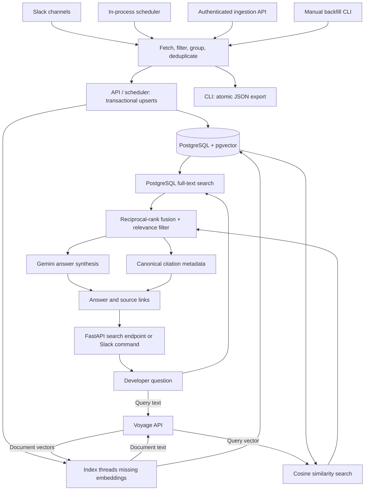

# Unblock - Slack Engineering Knowledge Retrieval

Unblock helps engineers find previous Slack discussions relevant to a problem.
It ingests useful conversations into PostgreSQL, generates Voyage embeddings,
combines keyword and vector search, and uses Gemini to generate answers backed
by source links. Developers query it through a FastAPI endpoint or an ephemeral
Slack `/unblock` command.

Search uses the indexed database, not live Slack search. Conversations must
first be ingested and persisted. Citations are built from stored metadata rather
than generated by the language model.

## High-level flow

Two connected flows turn past conversations into useful answers: **build the
knowledge base**, then **search it when an engineer needs help**.

```text
BUILD THE KNOWLEDGE BASE                  ANSWER A DEVELOPER'S QUESTION

Slack engineering conversations          Developer asks via /unblock or API
              |                                         |
              v                                         v
Fetch messages and thread replies        Embed the question with Voyage
              |                                         |
              v                                         v
Filter noise, group useful threads       Search the indexed knowledge base
              |                          (keyword + semantic similarity)
              v                                         |
Store in PostgreSQL + index with Voyage -----------------+
                                                        |
                                                        v
                                         Merge and rank relevant threads
                                                        |
                                                        v
                                         Gemini drafts an evidence-based answer
                                                        |
                                                        v
                                         Return answer + original Slack links
```

Ingestion runs on a schedule or through the ingestion API. Questions search the
stored knowledge base rather than fetching Slack history again. If evidence is
weak or missing, the system is designed to say so instead of guessing.

## Tech stack

| Layer | Technology | Role |
|---|---|---|
| Runtime | Python 3.11 in the Docker image | Services, scripts, and application runtime |
| Database | PostgreSQL 16 | Slack data and English-language full-text search |
| Vector search | pgvector | Cosine similarity search with an IVFFlat index |
| Database access | SQLAlchemy 2.x and psycopg 3 | Synchronous sessions and PostgreSQL connectivity |
| Schema management | Alembic | Versioned database migrations |
| Embeddings | Voyage API through `voyageai` | Document/query vectors; default model `voyage-4` |
| Answer generation | Gemini `generateContent` API through HTTPX | Evidence-grounded synthesis; default model `gemini-3.5-flash-lite` |
| Token counting | tiktoken | Input-length validation using `cl100k_base` |
| Data contracts | Python dataclasses and Pydantic 2 | Internal models and API validation |
| Configuration | python-dotenv and pydantic-settings | Environment and local `.env` configuration |
| HTTP API | FastAPI and Uvicorn | Ingestion, search, health, and thread inspection |
| Slack integration | Slack Bolt and Slack SDK | History ingestion, Socket Mode, and Block Kit responses |
| Testing | unittest, unittest.mock, pytest, and pytest-asyncio | Unit tests and asynchronous test support |
| Deployment | Docker, Docker Compose, and Render blueprint | Packaging, local database, and hosted configuration |

Dependency ranges are maintained in [requirements.txt](requirements.txt);
they are not exact installed-version pins. Model defaults can be overridden
through environment configuration.

## Architecture



The two search branches execute sequentially in the current service. The bot
calls the Python retrieval service directly, not the HTTP endpoint.

## Folder structure

```text
main.py      FastAPI routes, authentication, startup tasks, and orchestration
ingestion/   Slack backfill, pagination, grouping, filtering, and scheduling
storage/     SQLAlchemy sessions, models, and transactional persistence
retrieval/   Embeddings, database search, ranking, and Gemini synthesis
bot/         Slack Socket Mode, /unblock command, and Block Kit formatting
shared/      Shared contracts and logging configuration
alembic/     Versioned database schema migrations
```

Retrieval internals:

```text
retrieval/
  embeddings/       Voyage configuration, provider wrapper, validation, batching
  search/           Database search, indexing, ranking, and public search service
  synthesis/        Gemini configuration, prompting, retries, and fallback
  scripts/          Indexing maintenance CLI
  tests/            Mocked provider/database and response tests
  models.py         Internal retrieval data contracts
  exceptions.py     Retrieval-specific errors
```

## Setup

Run commands from the repository root.

1. Clone the repository and prepare Python dependencies:
   ```sh
   python3 -m venv .venv
   source .venv/bin/activate
   pip install -r requirements.txt
   ```
2. Copy the environment template:
   ```sh
   cp .env.example .env
   ```
   Replace placeholders with real local settings. Set `DATABASE_URL` to a valid
   PostgreSQL connection URL. The local Compose database uses host `localhost`,
   port `5433`, and database/user/password `unblock`. Add `SLACK_APP_TOKEN` to
   `.env`; it is required but missing from the template.
3. Start PostgreSQL with pgvector:
   ```sh
   docker compose up -d db
   ```
   Host port **5433** avoids a conflict with local PostgreSQL on 5432. First
   initialization enables the `vector` extension but does not create tables.
4. Apply migrations after configuring the database URL:
   ```sh
   alembic upgrade head
   ```
5. Configure Slack and provider settings described below, then start one worker:
   ```sh
   uvicorn main:app --host 127.0.0.1 --port 8000 --workers 1
   ```

Migrations create `channels`, `threads`, `messages`, `embeddings`,
`ingestion_runs`, and `feedback`. The latter two have schema support but are
not currently populated by application flows. Interactive API documentation is
at `http://127.0.0.1:8000/docs`.

### Inspecting the database in DBeaver

| Field | Local development value |
|---|---|
| Host | `localhost` |
| Port | `5433` |
| Database | `unblock` |
| Username | `unblock` |
| Password | `unblock` |

SSL can be disabled for this local container only. Browse the `public` schema
to inspect tables. Do not reuse these development credentials for deployment.

## Slack app setup

Install a Slack app with bot scopes `channels:history` and `channels:read`.
Use its bot token (usually `xoxb-`), not a user token, as `SLACK_BOT_TOKEN`.
Invite the bot to each monitored public channel.

Private channels also require `groups:history` and `groups:read`. Reinstall the
app after changing scopes and invite it to the private channel; scopes alone
do not grant channel membership.

Use actual channel IDs, not names, in `SLACK_CHANNEL_IDS` and API paths. The
channel and token must belong to the same workspace. Channel configuration uses
JSON syntax, for example `["C0123ABCD456"]`.

For `/unblock`, enable Socket Mode, create an app-level token with
`connections:write`, and configure `SLACK_APP_TOKEN`. Add the bot scope
`commands`, reinstall the app, and register `/unblock` under
**Features > Slash Commands**. Socket Mode does not require a public command
Request URL.

If Slack returns `channel_not_found`, verify the ID, workspace, installation,
scopes, and bot membership. This error can indicate inaccessible private
channels as well as invalid IDs.

## Slack ingestion

All ingestion paths share filtering, grouping, and deduplication:

1. Read the channel checkpoint and fetch history after it using Slack cursors.
2. Filter bot/system messages and empty or reaction-only noise.
3. Fetch replies for affected threads, including older roots returned by Slack.
4. Group and chronologically sort messages, then deduplicate threads/messages.
5. Keep threads with code, error keywords, or resolution phrases, and fetch
   missing root permalinks.
6. Stage a checkpoint in memory; commit it only after output succeeds.

Useful-signal detection is heuristic, not proof that a conversation is resolved.
Slack rate limits wait for `Retry-After`; selected transient failures use
exponential backoff with jitter.

### Database ingestion API

Generate a private API key (for example, `openssl rand -hex 32`), configure it as
`INGESTION_API_KEY`, and supply it in `X-API-Key`. Replace the channel and key:

```sh
curl -X POST http://127.0.0.1:8000/api/v1/ingestion/channels/C0123ABCD456 \
  -H "X-API-Key: YOUR_INGESTION_API_KEY"
```

The API upserts channels, threads, and messages in one transaction, indexes
missing embeddings in a separate transaction, and only then advances the
checkpoint. If indexing fails, stored messages remain but progress does not
advance. Retrying upserts avoids duplicate primary keys.

Responses contain `channel_id`, `threads_saved`, `messages_saved`, and
`embeddings_indexed`. Saved counts describe submitted records, not only new
inserts. Indexing scans missing vectors across all channels.

### Scheduled ingestion and application lifecycle

FastAPI startup launches the ingestion scheduler and Slack bot. The scheduler
first waits **60 seconds**, reads `SLACK_CHANNEL_IDS`, then processes channels
sequentially through the same database ingestion flow. It waits another 60
seconds after the cycle, so ingestion time adds to the interval. Per-channel
failures are logged without terminating the loop.

Run **one worker and one application instance**: multiple workers or replicas
start duplicate schedulers and bot connections. Shutdown cancels and awaits
both tasks. `/health` checks the database, not the bot or AI providers.

### Manual JSON backfill

```sh
python -m ingestion.scripts.backfill --channel C0123ABCD456
```

Repeat `--channel` for multiple channels, omit it to use `SLACK_CHANNEL_IDS`, or
set `--output` to choose another export path. The default output is
`output/threads.json`, containing `thread_count` and a `threads` list. Each
thread includes its channel ID, root timestamp, root message, ordered messages,
and optional permalink.

This CLI writes JSON only; it does not populate PostgreSQL or generate
embeddings. Use the API or scheduler for searchable database data. There is no
provided JSON-to-database import command.

The JSON file is atomically replaced, not appended, before checkpoints advance.
If output fails, the same history can be fetched again. The default checkpoint
is `storage/checkpoints.json`. Use a separate `CHECKPOINT_FILE` for export-only
workflows so an export cannot skip messages not yet persisted in PostgreSQL.

The CLI takes a non-blocking process lock for its checkpoint. This does not
coordinate API or scheduler requests. Atomic checkpoint replacement is not
multi-writer locking; avoid overlapping ingestion runs.

## HTTP API and contracts

All `/api/v1/...` routes require `X-API-Key`, compared using
`hmac.compare_digest`. An unconfigured server key returns 503; an absent or
incorrect client key returns 401.

| Method and route | Purpose |
|---|---|
| `GET /health` | Public database connectivity check |
| `POST /api/v1/ingestion/channels/{channel_id}` | Ingest, persist, index, then advance progress |
| `POST /api/v1/unblock` | Search and generate an answer |
| `GET /api/v1/threads` | List threads with optional `channel_id`, `limit` (default 50, maximum 200), and nonnegative `offset` |
| `GET /api/v1/threads/{thread_id}` | Retrieve a thread, or 404 |

Thread responses include `id`, `channel_id`, `created_at`, and messages with
`id`, `author`, `text`, `posted_at`, and `permalink`. Messages are chronological;
thread lists sort by database insertion time, not original Slack posting time.

Contracts in [shared/models.py](shared/models.py):

```python
SearchRequest(query: str)
Citation(thread_id: str, permalink: str, snippet: str)
SearchResponse(answer: str, citations: list[Citation])
```

Example local search:

```sh
curl -X POST http://127.0.0.1:8000/api/v1/unblock \
  -H "X-API-Key: YOUR_INGESTION_API_KEY" \
  -H "Content-Type: application/json" \
  -d '{"query":"Why does the worker return a 500 error?"}'
```

HTTP search rejects blank questions with 422. Slack commands acknowledge
immediately, return usage for empty input, and respond ephemerally. Both paths
run synchronous retrieval in a thread pool. Use HTTPS for remote traffic.

## Configuration

Keep actual credentials in protected environment variables or local `.env`,
never source control. Ingestion settings are cached; retrieval configuration
loads at module import. Restart after changing settings.

| Variable | Default / purpose |
|---|---|
| `DATABASE_URL` | Valid PostgreSQL connection URL |
| `SLACK_BOT_TOKEN` | Required bot token for Slack API access |
| `SLACK_APP_TOKEN` | Required app-level Socket Mode token; add it to `.env` |
| `SLACK_CHANNEL_IDS` | JSON array of channel IDs; defaults to `[]` |
| `INGESTION_API_KEY` | Shared secret for protected HTTP routes |
| `SLACK_PAGE_SIZE` | 200; allowed 1-200 |
| `SLACK_MAX_RETRIES` | 5 retries after the initial Slack attempt |
| `SLACK_INITIAL_BACKOFF_SECONDS` | 1.0 seconds |
| `CHECKPOINT_FILE` | `storage/checkpoints.json` |
| `OUTPUT_FILE` | `output/threads.json` for manual export |
| `EMBEDDINGS_API_KEY` | Required Voyage key |
| `EMBEDDINGS_MODEL` | `voyage-4` |
| `EMBEDDINGS_DIMENSION` | 1024 for the default model; otherwise inferred by retrieval unless explicitly set |
| `MAX_CHUNK_TOKENS` | 500, for both document text and questions |
| `EMBEDDINGS_BATCH_SIZE` | 96 texts per provider request |
| `EMBEDDINGS_MAX_RETRIES` | 4 total attempts in the current implementation |
| `EMBEDDINGS_RETRY_BASE_DELAY` | 1.0 seconds; exponential backoff |
| `GEMINI_API_KEY` | Required Gemini key for normal search |
| `GEMINI_MODEL` | `gemini-3.5-flash-lite` |
| `GEMINI_API_BASE_URL` | `https://generativelanguage.googleapis.com/v1beta` |
| `GEMINI_TIMEOUT_SECONDS` | 30 seconds per request |
| `LOG_LEVEL` | `INFO` |
| `PORT` | Used by the Docker startup command |

Both Slack tokens are required by the shared ingestion settings, even for
manual export. `SLACK_SIGNING_SECRET` appears in the template but is not
explicitly consumed by the current Socket Mode setup.

The initial migration creates a 1024-dimensional vector column. A dimension
change requires a migration, not just an environment update. Changing embedding
models also requires reindexing, even if dimensions are equal.

## Retrieval entry points

| Entry point | Purpose |
|---|---|
| `retrieval.search.RetrievalSearchService.search` | Returns `SearchResponse` for the bot or API |
| `RetrievalSearchService.search_session` | Returns ranked candidates with a caller-provided session |
| `retrieval.search.index_missing_thread_embeddings` | Embeds persisted threads without an embedding row |
| `retrieval.embeddings.EmbeddingService` | Validates and embeds document text or questions |
| `retrieval.synthesis.GeminiSynthesisService` | Generates an answer from candidate evidence |

Direct synchronous Python usage:

```python
from retrieval.search import RetrievalSearchService
from shared.models import SearchRequest

response = RetrievalSearchService().search(
    SearchRequest(query="Why does the worker return a 500 error?"),
    limit=5,
)
print(response.answer)
for citation in response.citations:
    print(citation.permalink)
```

### Document indexing flow

Run indexing after database ingestion:

```sh
python -m retrieval.scripts.index_embeddings
```

1. Select threads without an `embeddings` row, oldest first.
2. Concatenate messages in posting order with `\n---\n` separators.
3. Preserve channel name, earliest posting time, first available author, and
   first available permalink as metadata.
4. Validate every text and call Voyage in batches with `input_type="document"`.
5. Validate vector dimensions, merge one embedding row per thread, and commit.

The function accepts an optional programmatic `limit`; the CLI has no limit
flag. API/scheduler ingestion also invokes it before advancing progress.

Token limits use tiktoken's `cl100k_base` encoding when installed, otherwise a
logged approximate word-based count. This is not necessarily Voyage's exact
token accounting. Empty text is rejected; an over-limit input raises
`ChunkTooLongError` before provider calls.

There is one vector per thread and no automatic splitting of long threads.
Existing vectors are not refreshed after message changes or new replies.
Changing models does not automatically re-embed existing rows.

### Query and ranking flow

With the default result limit of five:

1. Embed the question with Voyage using `input_type="query"`.
2. Fetch up to ten keyword candidates using PostgreSQL
   `plainto_tsquery('english', query)` and `ts_rank_cd` over generated message
   search vectors.
3. Fetch up to ten vector candidates using pgvector cosine distance;
   similarity is `1 - cosine_distance`.
4. Merge by thread ID using reciprocal-rank fusion:
   `RRF score = sum(1 / (60 + rank))` across lists containing the thread.
5. From the fused list of up to ten, keep keyword hits and vector-only hits
   with similarity at least `0.30`, then select the first five.

Fusion ranks by list position, not by comparing raw keyword/vector score
scales. The main search method closes its database session before synthesis.

Keyword SQL concatenates only matching messages; vector SQL concatenates all
joined messages. When both strategies return a thread, fusion retains the
keyword candidate's document text and metadata.

### Answer generation and citations

Gemini receives the question and candidate text. Instructions require grounded
answers, explicit uncertainty, separate alternative causes, and verification
steps where supported. They ask Gemini not to generate URLs or a Sources
section because the application supplies canonical links.

No candidates return `No strong match was found in the indexed Slack threads.`
without a Gemini HTTP call. The normal search-service constructor still
requires both providers' configuration.

Each result with a permalink contributes a citation containing the thread ID,
link, and first 300 characters of candidate text. Missing links are skipped.
Citations describe retrieved evidence, not verified per-claim attribution.

The bot normalizes generated Markdown to Slack formatting, removes a generated
sources section if present, and adds Block Kit answer/source blocks with a
plain-text fallback.

### Retrieval errors and fallback

All package-specific exceptions derive from `RetrievalError`.

| Condition | Behavior |
|---|---|
| Missing provider configuration | `ConfigError` |
| Empty embedding input | `EmbeddingAPIError` |
| Text exceeds the token limit | `ChunkTooLongError` |
| Embedding provider failures | Exponential retry delays, then `EmbeddingAPIError` |
| Unexpected vector dimensions | `EmbeddingAPIError` |
| Gemini transient HTTP/network failure | Two retries, waiting one and then two seconds |
| Gemini transient retries exhausted | Explicit outage message followed by the top candidate text |
| Gemini non-transient HTTP failure | `SynthesisAPIError`, without retries |
| Unexpected Gemini response shape | `SynthesisAPIError` |
| Empty Gemini answer text | No-strong-match answer |

Gemini retryable statuses are 408, 429, 500, 502, 503, and 504. The search API
maps handled database/retrieval errors to 503; Slack logs errors and returns a
temporary-failure message. There is no keyword-only fallback for a Voyage
outage because query embedding runs before either database search.

## Schema and migrations

SQLAlchemy models in `storage/models/` own the schema; Alembic applies changes.
The SQL file in `storage/migrations/` only enables `vector` on first local
database initialization and does not create tables.

Messages have a persisted English-language search vector and GIN index.
Embeddings have a cosine IVFFlat index. `feedback` supports `up`/`down`
reactions, and `ingestion_runs` supports run status/counts, but neither flow is
currently wired into the application.

To change the schema:

1. Edit or add models and register new ones in `storage/models/__init__.py`.
2. Generate a migration:
   ```sh
   alembic revision --autogenerate -m "describe the change"
   ```
3. Review the generated file, especially pgvector imports and index definitions.
4. Apply it:
   ```sh
   alembic upgrade head
   ```

Coordinate schema changes with ingestion and retrieval owners.

## Deployment and operational boundaries

The Dockerfile uses Python 3.11 slim, installs requirements, and runs migrations
before starting Uvicorn on `$PORT`. Compose starts only the local database.
`render.yaml` defines a Docker web service and PostgreSQL 16 database, with
Slack/provider secrets supplied by the operator.

On managed PostgreSQL, enable `vector` before migrations. The application image
does not run local database initialization SQL against a remote database.
Preserve checkpoint state: the Render blueprint does not configure a persistent
checkpoint disk.

Provider calls send document/query text to Voyage and questions plus retrieved
evidence to Gemini. Use approved providers and appropriate data-handling
settings. Search spans the indexed corpus without a requester-specific
channel-membership filter; ephemeral delivery does not enforce source-channel
permissions. The shared HTTP key does not provide per-user corpus authorization.

Compose credentials are for local development and its database port is
published without a loopback-only binding. Restrict access, use production
secrets, protect remote API traffic with TLS, and rotate credentials. No
application-level rate limiting or per-caller API scopes are implemented.

The system does not synchronize Slack deletions, verify every generated claim,
or guarantee that retained threads are resolved. Keep source links available
for users to inspect original context.

## Tests

From the repository root:

```sh
python -m pytest ingestion/tests retrieval/tests bot/tests
```

For retrieval only:

```sh
python -m pytest retrieval/tests
# Alternatively:
python -m unittest discover -s retrieval/tests -p "test_*.py"
```

Coverage includes pagination, deferred checkpoints, persistence/rollback, API
authentication, blank questions, embedding input types and metadata, database
result mapping, missing-vector indexing, relevance filtering, Gemini retries
and fallback, and Slack formatting. Tests primarily use fakes and mocks; they
do not establish live provider or database connectivity.

## Contribution workflow

- Branch off `main` for each feature.
- Open a PR before merging; at least one other developer reviews it.
- Coordinate changes to `shared/models.py` with the team because API and bot
  integrations depend on these contracts.
